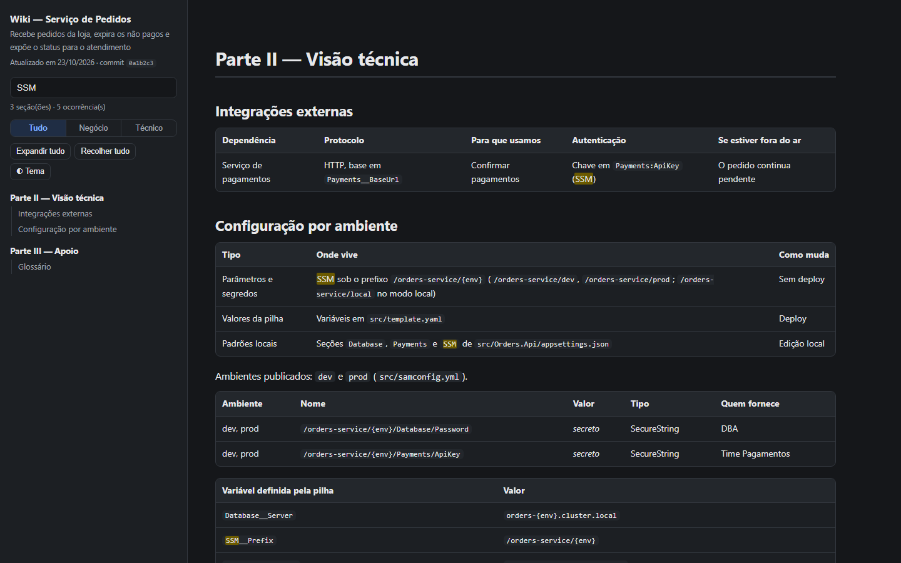
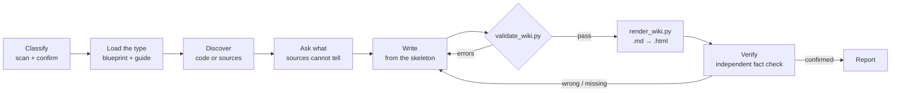

<div align="center">

# document-anything

**Point it at a codebase, a process or a product. Get documentation written twice: once for the AI agents that will work on it, once for the people who will run it.**

An agent skill that works out what it is documenting, adapts its process to that type, and writes a Markdown + HTML pair.
Deterministic validators check that nothing was left out, nothing was invented and nothing secret leaked.

[](LICENSE)


[Quick start](#quick-start) · [What it documents](#what-it-documents) · [What you get](#what-you-get) · [How it works](#how-it-works) · [The gates](#the-gates) · [CI](#keep-it-honest-in-ci) · [FAQ](#faq) · [Português](README.pt-BR.md)

<br>


</div>

---

## Why

Documentation fails in predictable ways:

- **It is never written.** Knowledge lives in one person's head until they move on.
- **It drifts.** A new environment variable, controller, scheduled job or approval step ships without a line of documentation.
- **It is written for one audience.** Product people cannot read it, or engineers cannot act on it.
- **When AI writes it, it can be confidently wrong.** Plausible endpoints, invented commands, made-up deadlines, pasted credentials.

`document-anything` makes an AI agent do the reading and the writing. It then runs deterministic, stdlib-only Python gates over the result, so a document only counts as done when its sources agree with it.

## What it documents

The skill classifies the subject first, confirms the type with you in one line, then runs the process for that type. Each type has its own blueprint of sections, its own reading plan and its own gates.

| Type | For | What the document centres on |
| --- | --- | --- |
| `service` | APIs, workers, consumers, function apps | Business view, architecture, API, messaging, jobs, **configuration per environment (SSM, secrets)**, run, test, deploy |
| `monolith` | One app, many business areas: MVC, layered/clean, vertical slice, hexagonal, modular, or a mix | **Architectural style**, module map, *how to add a feature*, screens, in-process jobs, `Web.config`/appsettings |
| `library` | Packages, SDKs, clients, shared kernels | Quick start, public API, options, compatibility and versioning, publishing |
| `frontend` | SPAs, SSR/SSG sites, mobile apps | Journeys, routes and screens, state and data, APIs consumed, design system and accessibility |
| `monorepo` | Several deployables in one repo | The map: every part with its type, dependency graph, tooling, conventions. Each part gets its own document |
| `infra` | Terraform, CDK, CloudFormation, Helm, K8s | Resource inventory, environments and state, networking, safe change workflow |
| `process` | How people and systems get something done | Roles, step-by-step table, **RACI**, rules and approvals, exceptions, SLAs, controls |
| `product` | A product or program | Audiences, features, metrics with exact definitions, roadmap, dependencies, operations |

Code types read the code, IaC, configuration and git history. Process and product read the documents, links and transcripts you give them, plus one structured interview. Every source is listed and cited.

## What you get

Every document is a pair with the same content:

| File | Written for | What it is |
| --- | --- | --- |
| `<name>.md` | AI agents | The source of truth: front matter (`type`, `as_of`, `source_commit` or `sources`), stable section markers, full detail. Ideal context for any agent working on the subject. |
| `<name>.html` | Humans | Generated from the `.md`. One file that opens in any browser: sidebar table of contents, full-text search with highlighting, an overview/detail filter labelled for the type, collapsible blocks, Mermaid diagrams, cards, dark mode, copy buttons on commands, print-friendly. |

<p align="center">


</p>
<p align="center">

</p>

## How it works



1. **Classify.** For code, `scan_repo.py` suggests the type with evidence (for example "46 controllers, `Web.config`, MVC + modules"). The skill confirms it with you in one line.
2. **Load the type.** The skill loads the type's blueprint (sections, gates, cross-checks) and its guide (sources of truth, reading plan, pitfalls).
3. **Discover.** Code types inventory the facts the gate will demand: routes, screens, controllers, environment variables, SSM/secret references, queues, schedules (including Hangfire/Quartz/cron in-process jobs), pipelines and committed credentials (file and key only, never values). Then the agent reads area by area, or module by module, in parallel sub-agents when the subject is large. Subject types read every source and record evidence.
4. **Ask.** One batch of questions only a person can answer. Whatever stays unanswered goes to *Open questions*; nothing is guessed.
5. **Write** from a generated skeleton with every marker in place.
6. **Gate and render.** The validator must pass; then the HTML is rendered deterministically.
7. **Verify.** The agent runs the safe commands the document shows, and a fresh verifier (author ≠ verifier) checks every claim against the sources.

## Quick start

**Requirements:** an agent that supports `SKILL.md` skills, Python 3.9+, and Node 16+ (only for the installer).

```bash
npx document-anything install --agent claude   # default: ~/.claude/skills/document-anything
npx document-anything install --agent copilot  # ~/.copilot/skills/document-anything
npx document-anything install --agent gemini   # ~/.gemini/skills/document-anything
npx document-anything install --agent codex    # ~/.agents/skills/document-anything
npx document-anything doctor                  # checks Python and the bundled scripts
```

Restart the agent session and ask:

> Document this repository.
>
> Documente o processo de reembolso. As fontes estão em `./sources`.
>
> Document the product. Here are the PRD, the metrics dashboard export and last quarter's roadmap.
>
> Update the documentation. *(re-reads only what changed since the document's `source_commit` or `as_of`)*

The document is written in the language you ask in (pt-BR and en built in). The skill writes only the two document files. It never commits, pushes, deploys or calls cloud APIs unless you ask.

<details>
<summary><b>Other install targets</b></summary>

```bash
npx document-anything install --agent copilot --project  # ./.github/skills/ (commit to share with the team)
npx document-anything install --agent agents             # shared ~/.agents/skills/ location
npx document-anything install --dir <skills-root>        # custom host's skills directory
npx document-anything install --force                    # replace a folder not installed by this package
npx document-anything where                          # print the install path
npx document-anything uninstall
```

`--agent agents` uses the interoperable `.agents/skills` location supported by Copilot, Gemini CLI and Codex. Grok and DeepSeek do not have a verified native Agent Skills install target here; use `--dir` only if your host supports the `SKILL.md` format and its custom skills location. The installable unit is the self-contained [`skill/`](skill/) folder, so copying it into a compatible skills directory also works.

</details>

## The gates

`validate_wiki.py` exits 1 on any error. Here is a real run against a service document with four planted mistakes:

```text
$ document-anything validate docs/wiki/orders-service.md --repo .
ERROR [anchors] link to `#glossario` has no matching heading (line 34)
ERROR [coverage] env_var `ORDERS_DEBUG` (src/Orders.Api/Endpoints/OrdersEndpoints.cs:9) is not mentioned; document it or add `<!-- coverage-ignore: ORDERS_DEBUG | reason -->`
ERROR [html-sync] orders-service.html is stale; run render_wiki.py orders-service.md
ERROR [placeholders] placeholder left in the text: `TODO` (line 121)
coverage: config_key 3/3, env_var 4/5, environment 2/2, iac_parameter 2/2, iac_resource 3/3, local_dependency 1/1, parameter_ref 3/3, pipeline 1/1, plaintext_secret 2/2, route 4/4, schedule 1/1, test_suite 1/1
FAIL: 4 error(s), 0 warning(s)
```

| Check | What it enforces |
| --- | --- |
| `front-matter` | `title`, `type`, `subject`, `lang`, `as_of`. Code types: a `source_commit` that exists in the repo's history. Process and product: a `sources` list |
| `structure` | the three parts and every required section of the type, each in its part, each followed by its heading |
| `content` | summary cards, required diagrams and tables, a dated status, at least 3 FAQ entries, shell command blocks each labelled as run, copied or derived, code examples (library), no empty cells or vague markers ("A definir", "?") in tables, `na` only where the type allows it |
| `crossref` | values that must agree across sections, by exact name: every role is a RACI column, every step owner is a listed role, every step has a RACI row with valid cells and exactly one A, every feature audience is a listed audience |
| `sources` | every source in the front matter is cited in *References* |
| `coverage` | every fact the type requires from the scan is mentioned in visible text, in its home section: environments in *Configuration*, routes in *API* with method and path together, screens in *Routes and screens*, controllers in the module map or UI, resources in the *Resource inventory*... An exclusion must be explicit: `<!-- coverage-ignore: fact \| reason -->` |
| `placeholders` | no `«…»` from the skeleton (not even inside code blocks), `TODO`, `TBD` or `{{…}}` |
| `secrets` | no tokens, keys or literal passwords, and none of the credential values found committed in the repo |
| `anchors`, `mermaid` | every `#link` resolves; diagram types are known and risky labels are quoted |
| `file-refs` | a quoted path whose folder exists but whose file does not is an error (typo or rename) |
| `html-sync` | the HTML carries the SHA-256 of the exact Markdown it was rendered from |

### What the scanner understands

| Area | Sources |
| --- | --- |
| Infrastructure | AWS SAM / CloudFormation, `samconfig`, Serverless Framework, Terraform, CDK, Kubernetes, docker-compose, Dockerfile |
| Configuration | `appsettings*.json`, `Web.config` + transforms, `.env*`, Spring, node-config, Angular `environment*.ts`, SSM / Secrets Manager references |
| Routes and screens | .NET (attributes, minimal APIs, FastEndpoints, conventional MVC routes, Razor Pages, Blazor), Node (Express, Fastify, Koa, Hono, NestJS), React Router, Angular, Vue Router, Next.js / Nuxt / SvelteKit file routing, Python (FastAPI, Flask, Django), Rails, Laravel, Spring, Go, Rust |
| Jobs | IaC schedules, Kubernetes CronJobs, Hangfire, Quartz, Spring `@Scheduled`, node-cron, Celery beat, .NET hosted services, Azure timer triggers |
| Structure | Packages and deployables, workspaces (npm/pnpm/yarn, Nx, Turborepo, Lerna), solutions, architectural style signals |
| Delivery and tests | Azure Pipelines, GitHub Actions, GitLab CI, Jenkins, Bitbucket, CodeBuild, CircleCI; .NET test projects, npm test scripts, test folders |

## Keep it honest in CI

Once something is documented, make drift a failing build.

<details open>
<summary><b>GitHub Actions</b></summary>

```yaml
- uses: actions/setup-python@v5
  with: { python-version: "3.12" }
- run: npx -y document-anything validate docs/wiki/orders-service.md --repo .
```

</details>

<details>
<summary><b>Azure Pipelines</b></summary>

```yaml
- task: UsePythonVersion@0
  inputs: { versionSpec: "3.12" }
- script: npx -y document-anything validate docs/wiki/orders-service.md --repo .
  displayName: Validate documentation
```

</details>

The build fails when someone adds a route, screen, controller, queue, job, environment variable or SSM reference without documenting it, edits the Markdown without re-rendering, or pastes a credential.

## FAQ

<details>
<summary><b>How does it know what it is documenting?</b></summary>

For code, the scanner scores structural signals and suggests a type, with the evidence:

- IaC, routes and queues point to a **service**;
- MVC folders, `Web.config` and many controllers point to a **monolith**;
- workspaces or several solutions point to a **monorepo**;
- a packable project with no entry point points to a **library**;
- a UI framework with no server routes points to a **frontend**;
- IaC with no application code points to **infra**.

For subjects without code, the request and the sources decide between **process** and **product**. In every case the agent confirms with you in one line before writing, and you can always name the type yourself.

</details>

<details>
<summary><b>Why two files instead of one?</b></summary>

They serve different readers. Agents work best with plain, complete, greppable Markdown, and the front matter tells them which commit or which sources the document describes. People work best with navigation, search, filters and diagrams. Rendering one from the other means they can never disagree, and `html-sync` proves it.

</details>

<details>
<summary><b>How reliable is a process or product document without code to check against?</b></summary>

Less than a code document, and the gates say so honestly. They enforce:

- that every source is listed and cited;
- that tables are complete (no empty owner, input, output or deadline);
- that roles and RACI agree;
- that unknowns go to *Open questions* instead of being guessed.

The independent verifier then checks every step, value and date against the sources.

</details>

<details>
<summary><b>Does the HTML need a server or an internet connection?</b></summary>

No server: CSS and JavaScript are inline, so you double-click the file or attach it to an email. Mermaid is the only external asset (pinned version, from jsDelivr). Offline, the diagrams show their source text and everything else works.

</details>

<details>
<summary><b>How does it handle secrets and personal data?</b></summary>

The agent is instructed never to read secret values (parameter stores, secret managers, `.env` files, CI variables). Documents say **where** each secret lives and **who** provides it. The scanner reports committed credentials by file and key only, and the validator blocks tokens, literal passwords, and any committed credential value that shows up in the document. Process documents keep personal data to the names and roles the sources give.

</details>

<details>
<summary><b>We already have docs. Will it overwrite them?</b></summary>

It reads existing docs as a source; when docs and code disagree, the code wins and the disagreement is recorded. An existing document without the skill's markers is migrated rather than rewritten, and the gate errors become the to-do list. Existing documents created by the skill are updated in place.

</details>

<details>
<summary><b>Which agents does it work with?</b></summary>

It is built for Claude Code and uses the open `SKILL.md` format, so agents that load skills from a folder can use it via `install --dir`. Parallel sub-agents and the independent verifier degrade gracefully to a single-agent pass where sub-agents are not available.

</details>

## Repository layout

```
bin/cli.js              installer and script runner (no dependencies)
skill/
├── SKILL.md            the router: classify, load the type, discover, write, gate, verify
├── blueprints/         common.json + one blueprint per type (sections, gates, coverage, cross-checks)
├── references/         classify, discovery, dialect, writing, verification, update, types/<type>.md
├── assets/             page CSS and JS
└── scripts/            scan_repo.py, new_doc.py, validate_wiki.py, render_wiki.py, wikilib.py
tests/                  unit tests + fixtures for every code type + complete service and process documents
docs/images/            screenshots used in this README
```

Sample documents: a service ([Markdown](tests/fixtures/orders-service/docs/wiki/orders-service.md) · [HTML](tests/fixtures/orders-service/docs/wiki/orders-service.html)) and a process ([Markdown](tests/fixtures/month-end-close/docs/process/fechamento-mensal.md) · [HTML](tests/fixtures/month-end-close/docs/process/fechamento-mensal.html)). Download an HTML file and open it to try the page.

## Development

```bash
python -m unittest discover -s tests    # unit + end-to-end tests
node bin/cli.js doctor
node bin/cli.js blueprint monolith      # print a type's blueprint
```

See [CONTRIBUTING.md](CONTRIBUTING.md) for how the pieces fit together and how to add a document type.

## License

[MIT](LICENSE)
