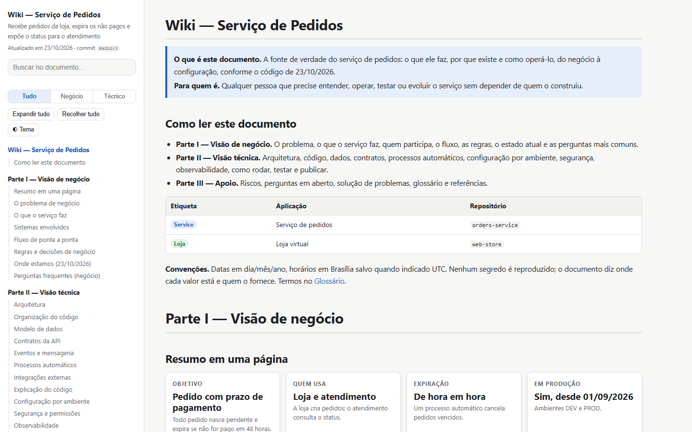
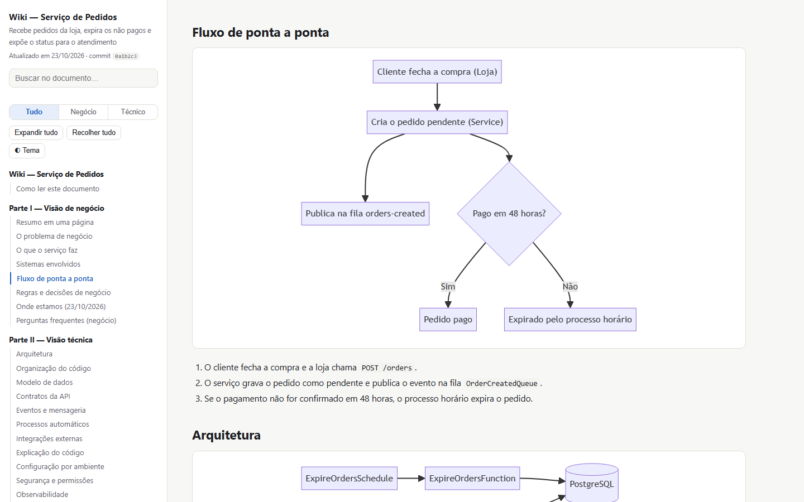
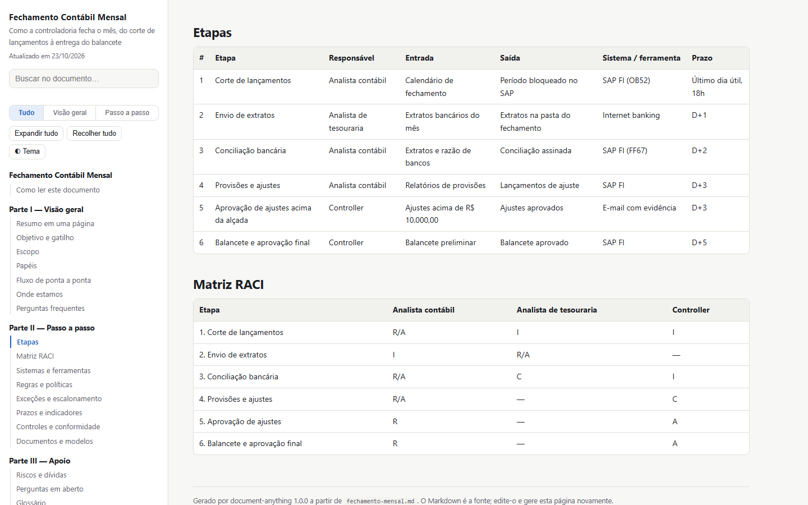

<div align="center">

# document-anything

**Aponte para um código, um processo ou um produto. Receba a documentação escrita duas vezes: uma para os agentes de IA que vão trabalhar nele, outra para as pessoas que vão operá-lo.**

Uma skill de agente que identifica o que está documentando, adapta o processo ao tipo e escreve um par Markdown + HTML.
Validadores determinísticos garantem que nada ficou de fora, nada foi inventado e nenhum segredo vazou.

[](LICENSE)


[Começo rápido](#começo-rápido) · [O que documenta](#o-que-documenta) · [O que você recebe](#o-que-você-recebe) · [Como funciona](#como-funciona) · [Os gates](#os-gates) · [CI](#mantenha-a-documentação-honesta-no-ci) · [English](README.md)

<br>



</div>

---

## Por quê

Documentação falha sempre do mesmo jeito:

- **Nunca é escrita.** O conhecimento fica na cabeça de uma pessoa até ela mudar de time.
- **Envelhece.** Uma variável de ambiente, controller, job agendado ou etapa de aprovação nova entra em produção sem uma linha de documentação.
- **Serve a um público só.** O negócio não entende, ou a engenharia não consegue agir a partir dela.
- **Quando uma IA escreve, pode errar com convicção.** Endpoints plausíveis, comandos inventados, prazos inventados, credenciais coladas.

Com o `document-anything`, um agente de IA lê o assunto e escreve a documentação. Depois, gates em Python, só com a biblioteca padrão, verificam o resultado. O documento só é dado como pronto quando as fontes concordam com ele.

## O que documenta

A skill classifica o assunto, confirma o tipo com você em uma linha e segue o processo daquele tipo. Cada tipo tem seu próprio blueprint de seções, plano de leitura e gates.

| Tipo | Para | Onde o documento se concentra |
| --- | --- | --- |
| `service` | APIs, workers, consumidores, funções | Visão de negócio, arquitetura, API, mensageria, jobs, **configuração por ambiente (SSM, segredos)**, rodar, testar, publicar |
| `monolith` | Uma aplicação com muitas áreas: MVC, camadas/clean, vertical slice, hexagonal, modular ou misto | **Estilo arquitetural**, mapa de módulos, *como adicionar uma funcionalidade*, telas, jobs no processo, `Web.config`/appsettings |
| `library` | Pacotes, SDKs, clientes, kernels compartilhados | Começo rápido, API pública, opções, compatibilidade e versionamento, publicação |
| `frontend` | SPAs, sites SSR/SSG, apps mobile | Jornadas, rotas e telas, estado e dados, APIs consumidas, design system e acessibilidade |
| `monorepo` | Vários deployables num repo | O mapa: cada parte com seu tipo, grafo de dependências, ferramentas, convenções. Cada parte ganha seu próprio documento |
| `infra` | Terraform, CDK, CloudFormation, Helm, K8s | Inventário de recursos, ambientes e state, rede, fluxo seguro de mudança |
| `process` | Como pessoas e sistemas fazem algo acontecer | Papéis, tabela passo a passo, **RACI**, regras e alçadas, exceções, SLAs, controles |
| `product` | Um produto ou programa | Públicos, funcionalidades, indicadores com definição exata, roadmap, dependências, operação |

Tipos de código leem código, IaC, configuração e histórico do git. Processo e produto leem os documentos, links e transcrições que você fornece, mais uma entrevista estruturada; toda fonte é listada e citada.

## O que você recebe

Todo documento é um par com o mesmo conteúdo:

| Arquivo | Para quem | O que é |
| --- | --- | --- |
| `<nome>.md` | Agentes de IA | A fonte de verdade: front matter (`type`, `as_of`, `source_commit` ou `sources`), marcadores estáveis de seção, todo o detalhe |
| `<nome>.html` | Pessoas | Gerado a partir do `.md`. Um arquivo que abre em qualquer navegador, com sumário lateral, busca com destaque, filtro de visão geral/detalhe com rótulos do tipo, blocos expansíveis, diagramas Mermaid, cartões, modo escuro, botão de copiar e boa impressão |

<p align="center">


</p>

## Como funciona

1. **Classificar.** No código, o `scan_repo.py` sugere o tipo com evidências (ex.: "46 controllers, `Web.config`, MVC + módulos"). A skill confirma com você em uma linha.
2. **Carregar o tipo.** A skill carrega o blueprint (seções, gates, verificações cruzadas) e o guia do tipo (fontes de verdade, plano de leitura, armadilhas).
3. **Descobrir.**
   - **Código:** o scanner inventaria o que o gate vai exigir: rotas, telas, controllers, variáveis, referências SSM/segredos, filas, jobs (inclusive Hangfire/Quartz/cron no processo), esteiras e credenciais commitadas (só arquivo e chave, nunca o valor). Depois o agente lê área por área, ou módulo por módulo, com subagentes em paralelo quando o assunto é grande.
   - **Processo e produto:** o agente lê cada fonte e registra evidências.
4. **Perguntar.** Uma única rodada de perguntas que só uma pessoa responde. O que ficar sem resposta vai para *Perguntas em aberto*; nada é chutado.
5. **Escrever.** Parte de um esqueleto gerado, com todos os marcadores no lugar.
6. **Gate e renderização.** O validador precisa passar; depois o HTML é gerado de forma determinística.
7. **Verificar.** O agente roda os comandos seguros que o documento mostra. Depois, um verificador independente (quem escreve não verifica) confere cada afirmação contra as fontes.

## Começo rápido

**Requisitos:** um agente que suporte skills `SKILL.md`, Python 3.9+ e Node 16+ (este só para o instalador).

```bash
npx document-anything install --agent claude   # padrão: ~/.claude/skills/document-anything
npx document-anything install --agent copilot  # ~/.copilot/skills/document-anything
npx document-anything install --agent gemini   # ~/.gemini/skills/document-anything
npx document-anything install --agent codex    # ~/.agents/skills/document-anything
npx document-anything doctor                  # confere o Python e os scripts
```

Reinicie a sessão do agente e peça:

> Documente este repositório.
>
> Documente o processo de reembolso. As fontes estão em `./fontes`.
>
> Documente o produto. Aqui estão o PRD, a exportação do painel de indicadores e o roadmap do trimestre.
>
> Atualize a documentação. *(relê só o que mudou desde o `source_commit` ou o `as_of` do documento)*

O documento sai no idioma do pedido (pt-BR e en embutidos). A skill escreve apenas os dois arquivos do documento. Ela nunca faz commit, push, deploy ou chamada a APIs de nuvem sem você pedir.

<details>
<summary><b>Outros destinos de instalação</b></summary>

```bash
npx document-anything install --agent copilot --project  # ./.github/skills/ (commit para compartilhar com o time)
npx document-anything install --agent agents             # local compartilhado ~/.agents/skills/
npx document-anything install --dir <skills-root>        # diretório customizado de outro host
npx document-anything install --force                    # substitui pasta não instalada por este pacote
npx document-anything where                              # mostra o caminho de instalação
npx document-anything uninstall
```

`--agent agents` usa o caminho interoperável `.agents/skills`, suportado pelo Copilot, Gemini CLI e Codex. Não há aqui um destino nativo de Agent Skills confirmado para Grok e DeepSeek; use `--dir` somente se o host aceitar o formato `SKILL.md` e tiver um local customizável para skills. A pasta [`skill/`](skill/) é autocontida; copiá-la para um diretório compatível também funciona.

</details>

## Os gates

O `validate_wiki.py` sai com código 1 em qualquer erro. Entre outras coisas, ele exige:

- **Estrutura do tipo:** as seções obrigatórias do tipo, cada uma na sua parte.
- **Conteúdo mínimo:** cartões, diagramas, tabelas e comandos onde o blueprint pede.
- **Tabelas completas:** etapas, papéis, RACI, funcionalidades e mapa do monorepo sem células vazias.
- **Verificações cruzadas, por nome exato:** todo papel é coluna da RACI, todo responsável de etapa é um papel listado, toda etapa tem linha na RACI com células válidas e exatamente um A, todo público de funcionalidade é um público listado.
- **Disciplina de escrita:** status datado, pelo menos 3 perguntas no FAQ, cada bloco de comando rotulado como executado, copiado ou derivado.
- **Fontes:** toda fonte do front matter citada nas referências.
- **Cobertura na seção certa:** ambientes em *Configuração*, rotas na *API* com método e caminho juntos, telas em *Rotas e telas*, controllers no mapa de módulos ou nas telas, recursos no inventário de infraestrutura.
- **Limpeza:** nenhum placeholder `«…»` do esqueleto (nem dentro de blocos de código) e nenhum segredo, inclusive valores commitados no repo.
- **Integridade:** âncoras, Mermaid, caminhos de arquivo e a sincronia MD↔HTML.

## Mantenha a documentação honesta no CI

```yaml
# Azure Pipelines
- task: UsePythonVersion@0
  inputs: { versionSpec: "3.12" }
- script: npx -y document-anything validate docs/wiki/orders-service.md --repo .
  displayName: Validar a documentação
```

O build quebra quando alguém adiciona rota, tela, controller, fila, job, variável ou parâmetro SSM sem documentar, edita o Markdown sem gerar o HTML de novo, ou cola uma credencial.

## Exemplos

- Serviço: [Markdown](tests/fixtures/orders-service/docs/wiki/orders-service.md) · [HTML](tests/fixtures/orders-service/docs/wiki/orders-service.html)
- Processo: [Markdown](tests/fixtures/month-end-close/docs/process/fechamento-mensal.md) · [HTML](tests/fixtures/month-end-close/docs/process/fechamento-mensal.html)

Baixe um HTML e abra no navegador.

## Desenvolvimento

```bash
python -m unittest discover -s tests
node bin/cli.js doctor
node bin/cli.js blueprint process --lang pt-BR
```

Veja o [CONTRIBUTING.md](CONTRIBUTING.md), inclusive como adicionar um tipo de documento.

## Licença

[MIT](LICENSE)
