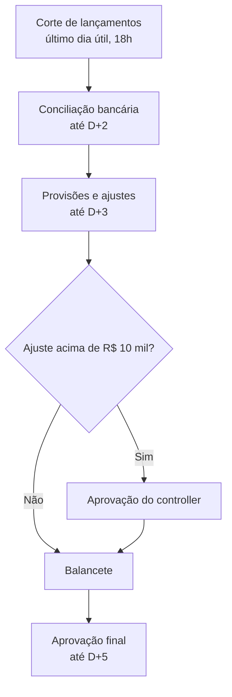

# Fechamento Contábil Mensal

> **O que é este documento.** A fonte de verdade sobre o fechamento contábil mensal: o que é, por que existe e como funciona, conforme as fontes de 23/10/2026.
>
> **Para quem é.** Qualquer pessoa que precise executar, aprovar, auditar ou melhorar o fechamento sem depender de quem o conhece hoje.

<!-- section: about -->
## Como ler este documento

- **Parte I — Visão geral.** O essencial, sem exigir conhecimento contábil aprofundado.
- **Parte II — Passo a passo.** O detalhe para quem executa e aprova cada etapa.
- **Parte III — Apoio.** Riscos, perguntas em aberto, glossário e referências.

**Convenções.** Datas no formato dia/mês/ano; "D+n" é o n-ésimo dia útil do mês seguinte ao fechado. Termos e siglas estão no [Glossário](#glossário).

<!-- part: overview -->
# Parte I — Visão geral

<!-- section: summary -->
## Resumo em uma página

<!-- cards -->
- **Objetivo** — Balancete fechado até D+5 | O mês só é considerado fechado depois da aprovação do controller.
- **Gatilho** — Último dia útil do mês | O corte de lançamentos acontece às 18h.
- **Responsável** — Controller | Aprova o balancete e os ajustes acima da alçada.
- **Sistema principal** — SAP FI | Todos os lançamentos e conciliações acontecem nele.
- **Situação** — Documentado e medido | O prazo de D+5 foi cumprido em 9 dos últimos 12 meses.
<!-- /cards -->

**Em uma frase:** no último dia útil o mês é cortado, as equipes conciliam bancos e provisões até D+3, o analista monta o balancete e o controller o aprova até D+5.

<!-- section: purpose -->
## Objetivo e gatilho

O fechamento existe para entregar à diretoria e à auditoria um balancete confiável do mês até o 5º dia útil seguinte. Ele começa automaticamente no último dia útil do mês, com o corte de lançamentos às 18h, e termina quando o controller aprova o balancete no SAP.

<!-- section: scope -->
## Escopo

Vale para as duas empresas do grupo no Brasil, todos os meses. Não cobre o fechamento anual (que tem etapas extras de auditoria externa) nem as subsidiárias no exterior, que fecham pelo processo da matriz.

<!-- section: roles -->
## Papéis

| Papel | Responsabilidade | Quem exerce hoje |
| --- | --- | --- |
| Analista contábil | Executa cortes, conciliações e monta o balancete | Equipe de contabilidade (3 pessoas) |
| Analista de tesouraria | Envia extratos e explica divergências bancárias | Equipe de tesouraria |
| Controller | Aprova ajustes acima da alçada e o balancete final | Marina Souza |

<!-- section: flow -->
## Fluxo de ponta a ponta

1. O analista contábil bloqueia novos lançamentos no último dia útil, às 18h.
2. Com os extratos da tesouraria, o analista concilia os bancos até D+2.
3. Até D+3 entram provisões e ajustes; os acima de R$ 10.000,00 precisam do controller.
4. O analista monta o balancete e o controller o aprova até D+5.

<!-- section: status -->
## Onde estamos

Em 23/10/2026: o processo é documentado e medido. O prazo de D+5 foi cumprido em 9 dos últimos 12 meses; os atrasos vieram da conciliação bancária. A automação da importação de extratos está planejada, sem data.

<!-- section: faq-business -->
## Perguntas frequentes

Posso lançar algo depois do corte?

Só com autorização do controller, registrada no chamado do fechamento.

Quem aprova um ajuste de R$ 15 mil?

O controller, conforme a Política de Alçadas Financeiras v2.

O que acontece se o fechamento passar de D+5?

O controller decide entre aprovar com a diferença em conta transitória ou adiar; a decisão fica registrada no chamado do mês.

<!-- part: detail -->
# Parte II — Passo a passo

<!-- section: steps -->
## Etapas

| # | Etapa | Responsável | Entrada | Saída | Sistema / ferramenta | Prazo |
| --- | --- | --- | --- | --- | --- | --- |
| 1 | Corte de lançamentos | Analista contábil | Calendário de fechamento | Período bloqueado no SAP | SAP FI (OB52) | Último dia útil, 18h |
| 2 | Envio de extratos | Analista de tesouraria | Extratos bancários do mês | Extratos na pasta do fechamento | Internet banking | D+1 |
| 3 | Conciliação bancária | Analista contábil | Extratos e razão de bancos | Conciliação assinada | SAP FI (FF67) | D+2 |
| 4 | Provisões e ajustes | Analista contábil | Relatórios de provisões | Lançamentos de ajuste | SAP FI | D+3 |
| 5 | Aprovação de ajustes acima da alçada | Controller | Ajustes acima de R$ 10.000,00 | Ajustes aprovados | E-mail com evidência | D+3 |
| 6 | Balancete e aprovação final | Controller | Balancete preliminar | Balancete aprovado | SAP FI | D+5 |

<!-- section: raci -->
## Matriz RACI

| Etapa | Analista contábil | Analista de tesouraria | Controller |
| --- | --- | --- | --- |
| 1. Corte de lançamentos | R/A | I | I |
| 2. Envio de extratos | I | R/A | — |
| 3. Conciliação bancária | R/A | C | I |
| 4. Provisões e ajustes | R/A | — | C |
| 5. Aprovação de ajustes | R | — | A |
| 6. Balancete e aprovação final | R | — | A |

<!-- section: systems-tools -->
## Sistemas e ferramentas

| Sistema / ferramenta | Usado em | Para quê | Acesso |
| --- | --- | --- | --- |
| SAP FI | Etapas 1, 3, 4 e 6 | Lançamentos, conciliações e balancete | Perfil de contabilidade, pedido ao TI |
| Internet banking | Etapa 2 | Extratos | Perfil de tesouraria |

<!-- section: business-rules -->
## Regras e políticas

| Regra | Detalhe | Motivo |
| --- | --- | --- |
| Alçada de ajustes | Ajustes acima de R$ 10.000,00 exigem aprovação do controller | Política de Alçadas Financeiras v2 |
| Prazo de fechamento | Balancete aprovado até D+5 | Calendário da diretoria |

<!-- section: exceptions -->
## Exceções e escalonamento

| Etapa | O que pode dar errado | Caminho alternativo | Quem decide | Fonte |
| --- | --- | --- | --- | --- |
| 2. Envio de extratos | Extrato não chega até D+1 | O analista contábil cobra a tesouraria e avisa o controller | Controller | Manual de Fechamento Contábil v3 (PDF, 11/2025) |
| 3. Conciliação bancária | Conciliação não fecha até D+2 | Diferença em conta transitória ou adiamento do fechamento, registrado no chamado | Controller | Entrevista com Marina Souza (controller), 20/10/2026 |

<!-- section: sla-metrics -->
## Prazos e indicadores

| Indicador | Definição | Meta | Fonte do dado | Quem acompanha |
| --- | --- | --- | --- | --- |
| Prazo de fechamento | Dias úteis entre o fim do mês e a aprovação do balancete | ≤ 5 | Data de aprovação no SAP | Controller |

<!-- section: controls -->
## Controles e conformidade

Toda conciliação é assinada pelo analista e guardada na pasta do fechamento por 5 anos. As aprovações de ajustes acima da alçada ficam no e-mail anexado ao chamado do mês.

<!-- section: artifacts -->
## Documentos e modelos

O modelo de conciliação bancária e o checklist do fechamento ficam na pasta compartilhada da controladoria, conforme o Manual de Fechamento Contábil v3.

<!-- part: appendix -->
# Parte III — Apoio

<!-- section: risks -->
## Riscos e dívidas

| Risco | Impacto | Severidade | Mitigação ou situação |
| --- | --- | --- | --- |
| Uma única pessoa no papel de controller | Fechamento parado nas férias | Alta | Definir substituto formal |
| Importação manual de extratos | Atrasos na conciliação | Média | Automação planejada |

<!-- section: open-questions -->
## Perguntas em aberto

| Pergunta | Por que importa | Quem pode responder |
| --- | --- | --- |
| Quem substitui o controller nas férias? | Sem substituto, ajustes acima da alçada ficam parados | Diretoria financeira |

<!-- section: glossary -->
## Glossário

| Termo | Significado |
| --- | --- |
| Balancete | Relatório com os saldos de todas as contas no fim do mês |
| D+n | n-ésimo dia útil após o fim do mês |

<!-- section: references -->
## Referências

| Fonte | Para que serviu |
| --- | --- |
| Manual de Fechamento Contábil v3 (PDF, 11/2025) | Etapas, prazos e controles |
| Política de Alçadas Financeiras v2 (02/2025) | Alçada de ajustes |
| Entrevista com Marina Souza (controller), 20/10/2026 | Papéis atuais, exceções e situação |

**Como este documento é mantido.** O `.md` é a fonte de verdade e o `.html` é gerado a partir dele pela skill `document-anything`.
