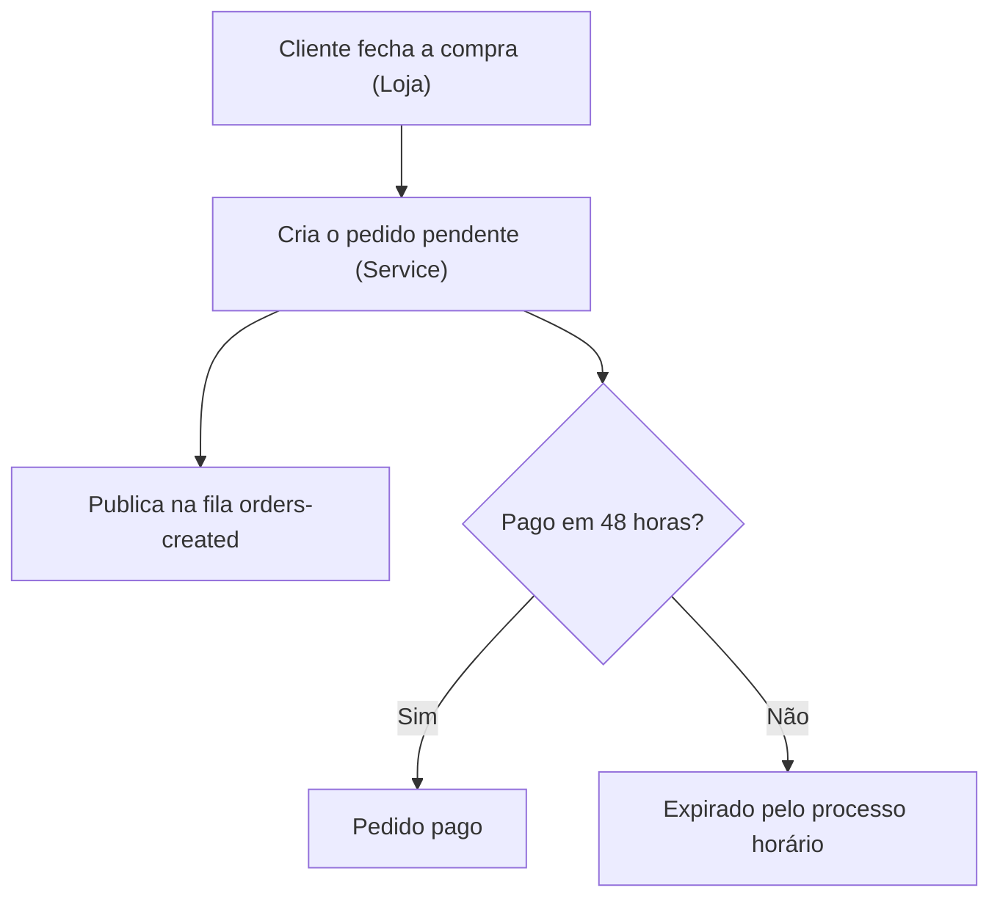
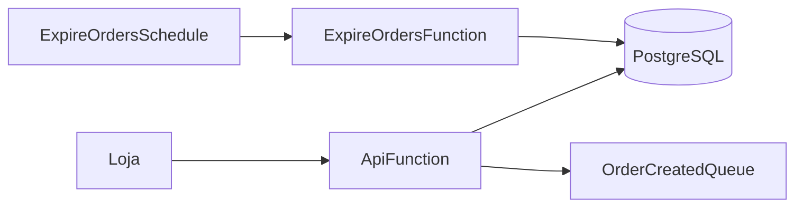

# Wiki — Serviço de Pedidos

> **O que é este documento.** A fonte de verdade do serviço de pedidos: o que ele faz, por que existe e como operá-lo, do negócio à configuração, conforme o código de 23/10/2026.
>
> **Para quem é.** Qualquer pessoa que precise entender, operar, testar ou evoluir o serviço sem depender de quem o construiu.

<!-- section: about -->
## Como ler este documento

- **Parte I — Visão de negócio.** O problema, o que o serviço faz, quem participa, o fluxo, as regras, o estado atual e as perguntas mais comuns.
- **Parte II — Visão técnica.** Arquitetura, código, dados, contratos, processos automáticos, configuração por ambiente, segurança, observabilidade, como rodar, testar e publicar.
- **Parte III — Apoio.** Riscos, perguntas em aberto, solução de problemas, glossário e referências.

| Etiqueta | Aplicação | Repositório |
| --- | --- | --- |
| (Service) | Serviço de pedidos | `orders-service` |
| (Loja) | Loja virtual | `web-store` |

**Convenções.** Datas em dia/mês/ano, horários em Brasília salvo quando indicado UTC. Nenhum segredo é reproduzido; o documento diz onde cada valor está e quem o fornece. Termos no [Glossário](#glossário).

<!-- part: overview -->
# Parte I — Visão de negócio

<!-- section: summary -->
## Resumo em uma página

<!-- cards -->
- **Objetivo** — Pedido com prazo de pagamento | Todo pedido nasce pendente e expira se não for pago em 48 horas.
- **Quem usa** — Loja e atendimento | A loja cria pedidos; o atendimento consulta o status.
- **Expiração** — De hora em hora | Um processo automático cancela pedidos vencidos.
- **Em produção** — Sim, desde 01/09/2026 | Ambientes DEV e PROD.
- **Dependência crítica** — Serviço de pagamentos | Confirma o pagamento de cada pedido.
<!-- /cards -->

**Em uma frase:** a loja (Loja) cria o pedido no serviço (Service), que o guarda como pendente, avisa quem precisa por fila e cancela automaticamente os que não forem pagos em 48 horas.

<!-- section: problem -->
## O problema de negócio

Antes do serviço, a loja reservava estoque para pedidos que nunca eram pagos, e o atendimento não tinha onde consultar a situação de um pedido.

1. Pedidos não pagos passam a expirar sozinhos e liberam o estoque.
2. O atendimento consulta o status de qualquer pedido por identificador.
3. Outros sistemas são avisados de cada pedido novo por fila, sem acoplamento.

<!-- section: capabilities -->
## O que o serviço faz

- **Criar pedidos** — usado pela loja (Loja) pela API.
- **Consultar um pedido** — usado pelo atendimento pela API.
- **Expirar pedidos vencidos** — processo automático de hora em hora.

**O que o serviço não faz.** Não cobra o cliente nem guarda dados de cartão: isso é do serviço de pagamentos.

<!-- section: context -->
## Sistemas envolvidos

| Sistema | Papel | Como se relaciona | Time responsável |
| --- | --- | --- | --- |
| Loja virtual (Loja) | Cria pedidos | Chama a API do serviço | Time Loja |
| Serviço de pagamentos | Confirma pagamentos | O serviço chama a API dele | Time Pagamentos |
| Atendimento | Consulta pedidos | Chama a API do serviço | Operação |

<!-- section: flow -->
## Fluxo de ponta a ponta



1. O cliente fecha a compra e a loja chama `POST /orders`.
2. O serviço grava o pedido como pendente e publica o evento na fila `OrderCreatedQueue`.
3. Se o pagamento não for confirmado em 48 horas, o processo horário expira o pedido.

<!-- section: business-rules -->
## Regras e decisões de negócio

| Regra | Detalhe | Motivo |
| --- | --- | --- |
| Prazo de pagamento | 48 horas, configurável por `Expiration__Hours` | Liberar estoque reservado |
| Pedido expirado não volta | Um pedido expirado não pode ser pago | Evitar venda sem estoque |

<!-- section: status -->
## Onde estamos

Em 23/10/2026: em produção desde 01/09/2026, em DEV e PROD. Nenhuma entrega pendente; a próxima evolução é a consulta por cliente, ainda sem data.

<!-- section: faq-business -->
## Perguntas frequentes (negócio)

<details markdown="1">
<summary>Um pedido expirado pode ser reativado?</summary>

Não. O cliente precisa fazer um novo pedido.

</details>

<details markdown="1">
<summary>Quanto tempo o cliente tem para pagar?</summary>

48 horas a partir da criação do pedido.

</details>

<details markdown="1">
<summary>O atendimento consegue ver um pedido de outro cliente?</summary>

Sim: a consulta é feita por identificador do pedido e exige o token do atendimento, não o do cliente.

</details>

<!-- part: detail -->
# Parte II — Visão técnica

<!-- section: architecture -->
## Arquitetura



| Unidade | Tipo | Gatilho | Runtime | Timeout |
| --- | --- | --- | --- | --- |
| `ApiFunction` | Função Lambda | HTTP (`HttpApi`, rota `/{proxy+}`) | .NET 8 | 30 s |
| `ExpireOrdersFunction` | Função Lambda | Agenda `ExpireOrdersSchedule` | .NET 8 | 120 s |
| `OrderCreatedQueue` | Fila SQS | Recebe um evento por pedido criado | — | — |

<!-- section: codebase -->
## Organização do código

| Projeto / pasta | Responsabilidade |
| --- | --- |
| `src/Orders.Api` | API HTTP: rotas em `src/Orders.Api/Endpoints/OrdersEndpoints.cs` |
| `src/Orders.Consumer` | Processo de expiração: `src/Orders.Consumer/ExpireOrders.cs` |
| `tests/Orders.Tests` | Testes de unidade (xUnit) |

Toda rota nova entra em `OrdersEndpoints.Map`, com uma linha `app.MapGet`/`app.MapPost`.

<!-- section: data-model -->
## Modelo de dados

Um banco PostgreSQL com a tabela `Orders` (identificador, situação, data de criação, valor). O servidor vem de `Database__Server`, definido pela pilha.

<!-- section: api -->
## Contratos da API

| Método | Rota | Finalidade | Autorização | Respostas |
| --- | --- | --- | --- | --- |
| `GET` | `/orders/{id}` | Consulta um pedido | Token do atendimento | 200, 404 |
| `POST` | `/orders` | Cria um pedido pendente | Token da loja | 201, 400 |
| `GET` | `/health` | Verificação de saúde | Nenhuma | 200 |
| `ANY` | `/{proxy+}` | Rota coringa do `HttpApi`: entrega qualquer outra rota à `ApiFunction`, onde o roteamento é feito pelo código | Conforme a rota | — |

Rotas novas não exigem mudança na pilha: basta registrá-las em `OrdersEndpoints.Map`.

<!-- section: messaging -->
## Eventos e mensageria

A fila `OrderCreatedQueue` (nome `orders-created-{env}`) recebe um evento por pedido criado. O produtor é a `ApiFunction`; os consumidores ficam em outros serviços.

<!-- section: jobs -->
## Processos automáticos

| Processo | Gatilho | O que faz | Timeout | Em caso de falha |
| --- | --- | --- | --- | --- |
| `ExpireOrdersSchedule` → `ExpireOrdersFunction` | `rate(1 hour)` | Expira pedidos pendentes há mais de `Expiration__Hours` horas | 120 s | A próxima execução retoma |

<!-- section: integrations -->
## Integrações externas

| Dependência | Protocolo | Para que usamos | Autenticação | Se estiver fora do ar |
| --- | --- | --- | --- | --- |
| Serviço de pagamentos | HTTP, base em `Payments__BaseUrl` | Confirmar pagamentos | Chave em `Payments:ApiKey` (SSM) | O pedido continua pendente |

<!-- section: code-walkthrough -->
## Explicação do código

<details markdown="1">
<summary>Criação de pedido</summary>

`OrdersEndpoints.Map` registra `POST /orders`, grava o pedido como pendente e publica o evento. A variável `ORDERS_DEBUG` liga logs detalhados.

</details>

<!-- section: configuration -->
## Configuração por ambiente

| Tipo | Onde vive | Como muda |
| --- | --- | --- |
| Parâmetros e segredos | SSM sob o prefixo `/orders-service/{env}` (`/orders-service/dev`, `/orders-service/prod`; `/orders-service/local` no modo local) | Sem deploy |
| Valores da pilha | Variáveis em `src/template.yaml` | Deploy |
| Padrões locais | Seções `Database`, `Payments` e `SSM` de `src/Orders.Api/appsettings.json` | Edição local |

Ambientes publicados: `dev` e `prod` (`src/samconfig.yml`). Cada um define os parâmetros da pilha `Stage` (nome do ambiente, sem padrão) e `SSMPrefix` (padrão `/orders-service/local`).

| Ambiente | Nome | Valor | Tipo | Quem fornece |
| --- | --- | --- | --- | --- |
| dev, prod | `/orders-service/{env}/Database/Password` | *secreto* | SecureString | DBA |
| dev, prod | `/orders-service/{env}/Payments/ApiKey` | *secreto* | SecureString | Time Pagamentos |

| Variável definida pela pilha | Valor |
| --- | --- |
| `Database__Server` | `orders-{env}.cluster.local` |
| `SSM__Prefix` | `/orders-service/{env}` |
| `Payments__BaseUrl` | `https://payments.example.com` |
| `Expiration__Hours` | `48` (só na `ExpireOrdersFunction`) |

<!-- section: security -->
## Segurança e permissões

As rotas de pedido exigem token; `/health` é pública. Os arquivos `src/Orders.Api/appsettings.json` e `src/docker-compose.yml` têm uma senha local em texto puro: mover para variável de ambiente local e trocar a senha.

<!-- section: observability -->
## Observabilidade

Os logs das funções vão para o CloudWatch, um grupo por função. Para achar uma expiração: filtre por `ExpireOrders` no grupo da `ExpireOrdersFunction`.

<!-- section: run-local -->
## Como rodar localmente

**Pré-requisitos.** .NET 8 SDK e Docker. O `src/docker-compose.yml` sobe o `postgres`.

Derivado de `src/docker-compose.yml` e do projeto `src/Orders.Api`; não executado (exige Docker e .NET 8).

```bash
docker compose -f src/docker-compose.yml up -d
dotnet run --project src/Orders.Api
```

<!-- section: tests -->
## Testes

O projeto `Orders.Tests` tem os testes de unidade (xUnit) e não precisa de banco.

Derivado de `tests/Orders.Tests/Orders.Tests.csproj`; não executado (exige .NET 8).

```bash
dotnet test tests/Orders.Tests
```

<!-- section: deploy -->
## Deploy, rollout e rollback

A esteira `azure-pipelines.yml` roda a cada commit na `main`: estágio Build e depois Deploy no ambiente `dev`. PROD é publicado com `sam deploy --config-env prod`. Para reverter, publique de novo a versão anterior.

<!-- section: dev-decisions -->
## Decisões técnicas

| Decisão | Motivo | Alternativas descartadas | Consequência | Fonte |
| --- | --- | --- | --- | --- |
| Expiração por agenda horária | Simples e barato | Fila com atraso por pedido | Até 1 hora de atraso na expiração | `src/template.yaml` |

<!-- part: appendix -->
# Parte III — Apoio

<!-- section: risks -->
## Riscos e dívidas

| Risco | Impacto | Severidade | Mitigação |
| --- | --- | --- | --- |
| Senha local em texto puro em `src/Orders.Api/appsettings.json` e `src/docker-compose.yml` | Vazamento se reutilizada | Baixa | Mover para variável de ambiente |
| Expiração com até 1 hora de atraso | Estoque preso por mais tempo | Baixa | Aceito |

<!-- section: open-questions -->
## Perguntas em aberto

| Pergunta | Por que importa | Quem pode responder |
| --- | --- | --- |
| Quem consome a fila `orders-created`? | Mudanças no evento podem quebrar consumidores | Arquitetura |

<!-- section: faq-technical -->
## Perguntas e respostas técnicas

<details markdown="1">
<summary>Onde mudo o prazo de expiração?</summary>

Na variável `Expiration__Hours` da `ExpireOrdersFunction`, em `src/template.yaml`, com deploy.

</details>

<details markdown="1">
<summary>Onde registro uma rota nova?</summary>

Em `OrdersEndpoints.Map`, no arquivo `src/Orders.Api/Endpoints/OrdersEndpoints.cs`; a rota coringa do `HttpApi` já entrega a chamada à `ApiFunction`.

</details>

<details markdown="1">
<summary>Como ligo os logs detalhados?</summary>

Defina a variável `ORDERS_DEBUG` na função; ela é lida em `OrdersEndpoints.Map`.

</details>

<!-- section: troubleshooting -->
## Solução de problemas

| Sintoma | Causa provável | Como confirmar | Como resolver |
| --- | --- | --- | --- |
| Pedidos não expiram | Agenda desligada ou função falhando | Logs da `ExpireOrdersFunction` | Corrigir o erro e aguardar a próxima hora |

<!-- section: glossary -->
## Glossário

| Termo | Significado |
| --- | --- |
| Pedido pendente | Pedido criado e ainda não pago |
| SSM | Parameter Store da AWS, onde ficam parâmetros e segredos |

<!-- section: references -->
## Referências

| Documento | Para que serve |
| --- | --- |
| `README.md` | Visão rápida do repositório |

**Como esta wiki é mantida.** O `.md` é a fonte e o `.html` é gerado pela skill `document-anything`.
